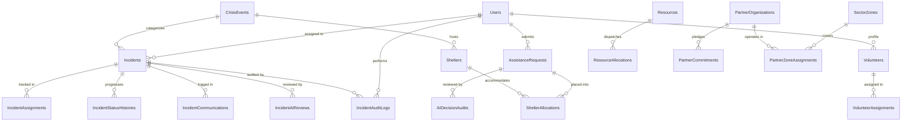

# Software Requirements Specification (SRS)
## For HumanAid: Humanitarian Crisis Management Platform

**Document Reference:** SRS-HUMANAID-2026-V1.0  
**Standard Compliance:** IEEE Std 830-1998 / ISO/IEC/IEEE 29148:2018  
**System Designation:** HumanAid Response Coordination Platform  
**Status:** Approved & Implemented  
**Date of Release:** November 2026  
**Version:** 1.0.0  

---

## Executive Metadata
- **Product Name:** HumanAid (formerly RELIEFCORE) Humanitarian Crisis Management Platform
- **Lead Architecture:** ASP.NET Core 8.0 Clean Architecture + React 18 Single Page Application
- **Primary Data Store:** Microsoft SQL Server (LocalDB / Enterprise) with Entity Framework Core 8
- **Geospatial Engine:** Leaflet OpenStreetMap Engine
- **Decision Engine:** GroqCloud / OpenAI API with Deterministic Rule-Based Fallback
- **Event Distribution:** Server-Sent Events (SSE) Real-Time Coordination Bus

---

## Table of Contents
1. [Introduction](#1-introduction)
   - 1.1 Purpose
   - 1.2 Document Conventions
   - 1.3 Intended Audience
   - 1.4 Product Scope
   - 1.5 References
2. [Overall Description](#2-overall-description)
   - 2.1 Product Perspective
   - 2.2 Product Functions Summary
   - 2.3 User Classes and Role Personas
   - 2.4 Operating Environment
   - 2.5 Design and Implementation Constraints
   - 2.6 Assumptions and Dependencies
3. [External Interface Requirements](#3-external-interface-requirements)
   - 3.1 User Interfaces
   - 3.2 Hardware Interfaces
   - 3.3 Software Interfaces
   - 3.4 Communications Interfaces
4. [System Features & Detailed Functional Requirements](#4-system-features--detailed-functional-requirements)
   - 4.1 System Feature 1: Authentication, Registration & Role Governance (FR-AUTH)
   - 4.2 System Feature 2: Citizen Emergency Intake & Tracking (FR-CITIZEN)
   - 4.3 System Feature 3: Emergency Coordinator Mission Command (FR-COORD)
   - 4.4 System Feature 4: Human-in-the-Loop AI Decision Review (FR-AI)
   - 4.5 System Feature 5: Incident Management & Duplicate Deduplication (FR-INCIDENT)
   - 4.6 System Feature 6: Supply Chain & Multi-Depot Logistics (FR-LOGISTICS)
   - 4.7 System Feature 7: Emergency Shelter & Evacuee Placement (FR-SHELTER)
   - 4.8 System Feature 8: Volunteer Management & AI Matching (FR-VOLUNTEER)
   - 4.9 System Feature 9: Donor Funding, Dual-Approval & Fraud Review (FR-DONOR)
   - 4.10 System Feature 10: Inter-Agency Partner Coordination (FR-PARTNER)
   - 4.11 System Feature 11: Real-Time Event Distribution (FR-REALTIME)
   - 4.12 System Feature 12: System Administration & Audit Logging (FR-ADMIN)
5. [Non-Functional Requirements (NFRs)](#5-non-functional-requirements-nfrs)
   - 5.1 Performance Requirements
   - 5.2 Safety & Disaster Survivability Requirements
   - 5.3 Security & Cryptographic Requirements
   - 5.4 Software Quality Attributes (Availability, Reliability, Maintainability, Usability)
   - 5.5 Privacy & Humanitarian Compliance Requirements
6. [Data Requirements & Schema Architecture](#6-data-requirements--schema-architecture)
   - 6.1 Entity Relationship Model
   - 6.2 Data Dictionary (Core Tables)
   - 6.3 Data Integrity & Concurrency Controls
7. [Verification & Traceability Matrix](#7-verification--traceability-matrix)
8. [Appendices & Glossary](#8-appendices--glossary)

---

## 1. Introduction

### 1.1 Purpose
This Software Requirements Specification (SRS) document provides a complete, unambiguous, and formal specification of the functional, operational, and non-functional requirements for the **HumanAid Humanitarian Crisis Management Platform**. It serves as the authoritative baseline for software engineers, quality assurance evaluators, academic reviewers, and emergency service stakeholders assessing system compliance and architectural maturity.

### 1.2 Document Conventions
This specification conforms to IEEE Std 830-1998 guidelines:
- **Mandatory Requirements:** Expressed using the modal verb **SHALL** (indicating binding contractual or functional necessity).
- **Recommended Requirements:** Expressed using the modal verb **SHOULD** (indicating industry best practice or preferred behavior).
- **Optional/Future Requirements:** Expressed using the modal verb **MAY** (indicating non-blocking roadmap enhancements).
- **Unique Identifiers:** Every functional requirement is indexed with a structured key (e.g., `FR-AUTH-01`, `FR-CITIZEN-03`, `NFR-SEC-02`).

### 1.3 Intended Audience
- **Systems Engineering & Development Teams:** Implements backend APIs, frontend portals, and persistence models.
- **QA & Testing Engineers:** Formulates automated unit, integration, stress, and user acceptance test cases.
- **Coursework Examiners & Academic Assessors:** Evaluates architectural design patterns, software engineering discipline, and project scope fulfillment.
- **Humanitarian Agencies & Disaster Coordinators:** Validates operational workflows against real-world crisis response scenarios.

### 1.4 Product Scope
HumanAid is a web-based, multi-tenant humanitarian disaster orchestration suite designed to coordinate emergency responses during natural disasters (floods, cyclones, landslides, tsunamis) and civil emergencies. The platform integrates:
- Public distress call handling with offline-tolerant submission.
- Real-time geospatial mapping and hazard zone tracking.
- Multi-factor automated triage prioritization with explainable AI reviews.
- Human-in-the-loop governance for all critical resource, shelter, and rescue assignments.
- Supply chain logistics monitoring from central depots to frontline evacuee shelters.
- Accredited NGO and international partner alignment under mutual aid frameworks.
- Dual-signoff financial governance for humanitarian donation disbursement.

### 1.5 References
1. IEEE Std 830-1998: *IEEE Recommended Practice for Software Requirements Specifications*.
2. ISO/IEC/IEEE 29148:2018: *Systems and software engineering — Life cycle processes — Requirements engineering*.
3. The Sphere Handbook: *Humanitarian Charter and Minimum Standards in Humanitarian Response* (2018 Edition).
4. OWASP Top 10 Application Security Risks (2021).
5. RFC 7519: *JSON Web Token (JWT) Architecture*.

---

## 2. Overall Description

### 2.1 Product Perspective
HumanAid functions as an autonomous, self-contained cloud or on-premise emergency web platform. It interacts with external telemetry systems, Large Language Model inference endpoints, and open-source mapping services:

```
+---------------------------------------------------------------------------------+
|                                External Actors                                  |
|   Affected Citizens | Coordinators | Logisticians | Shelter Staff | Partners    |
+---------------------------------------------------------------------------------+
                                      | (HTTPS / WSS / SSE)
                                      v
+---------------------------------------------------------------------------------+
|                        HumanAid Frontend Application                            |
|             React 18 + Vite SPA | HumanAid Organic Design System                |
+---------------------------------------------------------------------------------+
                                      | (REST JSON API / SSE Streams)
                                      v
+---------------------------------------------------------------------------------+
|                        HumanAid Backend Web API Core                            |
|        ASP.NET Core 8.0 Web API | Clean Architecture | Event Bus Engine         |
+---------------------------------------------------------------------------------+
         |                           |                            |
         v                           v                            v
+------------------+       +-------------------+       +--------------------------+
|  Primary Store   |       | External Services |       | Local Fallback Engines   |
| Microsoft SQL DB |       | GroqCloud/OpenAI  |       | RuleBasedFallbackAI      |
| LocalDB/Server   |       | OpenStreetMap GIS |       | Static Geocoder Cache    |
+------------------+       +-------------------+       +--------------------------+
```

### 2.2 Product Functions Summary
1. **User Identity & Access Management:** Registration, role assignment, credential hashing, and JWT authorization.
2. **Citizen Distress Intake:** Capture of distress requests with categories, vulnerable counts, and geolocation.
3. **Emergency Cockpit & Situational Triage:** Real-time metrics, emergency broadcast dispatcher, and case management.
4. **AI-Assisted Decision Making:** Automated extraction of casualty risk, medical necessity, and confidence scoring.
5. **Deduplication Engine:** Automated geographical and contact matching of redundant distress calls.
6. **Inventory & Depot Logistics:** Stock balances, requisition approvals, delivery manifests, and threshold alerts.
7. **Shelter & Evacuee Placements:** Capacity monitoring, bed assignments, dietary restrictions, and shelter transfers.
8. **Volunteer Mobilization & Roster:** Skill verification, shift assignment, availability calendars, and GPS dispatch.
9. **Donation Transparency & Dual-Signoff:** Fund allocations requiring dual-signoff and anomaly detection.
10. **Partner Alignment & Commitments:** Accredited NGO pledges, mutual aid MOUs, and inter-agency timeline.
11. **Event Streaming:** Real-time push updates for mission dashboards via Server-Sent Events (SSE).

### 2.3 User Classes and Role Personas

| Role Name | Access Code | Persona Summary | Primary Objectives |
|---|:---:|---|---|
| **Citizen / Affected Person** | `Citizen` | Displaced individual, family member, or community leader in a crisis zone. | Report immediate danger, locate emergency shelters, track rescue status. |
| **Emergency Coordinator** | `Coordinator` | Tactical mission director at central headquarters command. | Triage citizen requests, direct high-level resources, review AI recommendations. |
| **Incident / Case Manager** | `CaseManager` | Field desk operative assigned to specific rescue missions. | Verify on-the-ground situations, merge duplicate cases, log communications. |
| **Logistics Manager** | `LogisticsManager` | Supply chain officer at central or regional warehouses. | Control inventory, approve allocation dispatches, track relief convoy trucks. |
| **Shelter Administrator** | `ShelterAdmin` | On-site officer managing an evacuation center or school facility. | Record evacuee intake, monitor occupancy limits, request relief kits. |
| **Field Volunteer** | `Volunteer` | Registered field worker deployed to shelters or relief points. | Browse eligible shifts, accept tasks, log service hours, report field status. |
| **Volunteer Coordinator** | `VolunteerCoordinator` | Officer overseeing recruitment, background checks, and rosters. | Verify certifications, match volunteers to specialized emergency tasks. |
| **Funding & Donor Officer** | `FundingOfficer` | Financial controller monitoring institutional and public aid. | Review donations, approve capital disbursements, audit suspicious spikes. |
| **Partner Organisation Officer** | `PartnerOfficer` | Representative of an accredited NGO, Red Cross, or military unit. | Register mutual aid commitments, coordinate relief convoys in assigned zones. |
| **System Administrator** | `Admin` | IT and systems engineering manager. | Audit security logs, manage accounts, review system telemetry and backups. |

### 2.4 Operating Environment
- **Server OS:** Windows Server 2022 / Windows 11, Ubuntu Linux 22.04 LTS, or Docker container.
- **Application Server:** Kestrel Web Server (.NET 8.0 Runtime).
- **Database Server:** Microsoft SQL Server 2019+ or SQL Server LocalDB v15.0+.
- **Client Browsers:** Chromium-based browsers (Chrome 110+, Edge 110+), Firefox 115+, Safari 16+.
- **Mobile Compatibility:** Responsive viewport scaling (375px to 2560px screen width).

### 2.5 Design and Implementation Constraints
1. **Clean Architecture Separation:** Domain Layer MUST have zero external library dependencies.
2. **Deterministic Fallback:** System MUST maintain 100% operational capability if external AI APIs (OpenAI/GroqCloud) become unreachable.
3. **No AI Hallucination Exposure:** AI recommendations SHALL NOT write state directly to production databases without human confirmation.
4. **Color Accessibility:** HumanAid design tokens (`#14291e`, `#dbe4c6`, `#f4f6f2`, `#3d6b4f`) MUST meet WCAG 2.1 AA contrast ratios (minimum 4.5:1 for body text).
5. **No Layout Collisions:** Route portals MUST NOT nest outer layout sidebars or topbars within sub-routes.

### 2.6 Assumptions and Dependencies
- Clients possess modern browser environments with JavaScript enabled.
- Network connectivity may fluctuate; therefore, the frontend must maintain localized optimistic UI state with retry loops.
- Local time is standardized in UTC across database columns with localized UTC+05:30 client formatting.

---

## 3. External Interface Requirements

### 3.1 User Interfaces
- **Visual Design Standard:** Grounded in the HumanAid Organic Design System, utilizing calming natural pine green, pale sage, and soft stone canvas.
- **Responsive Layout:** CSS Grid and Flexbox layouts guaranteeing responsiveness across smartphones (375px), tablets (768px), laptops (1280px), and widescreen command centers (1920px+).
- **Accessibility:** Keyboard tab navigation, explicit `aria-label` tags on icon buttons, high-contrast modal dialogs, and clear toast notification banners.

### 3.2 Hardware Interfaces
- **GPS / Geolocation Receivers:** Consumes HTML5 Geolocation API (`navigator.geolocation.getCurrentPosition`) for automated coordinate capture on citizen devices.
- **Display Resolution:** Optimized for high-density command center displays and outdoor mobile devices under high sunlight glare.

### 3.3 Software Interfaces
- **Microsoft SQL Server Database:** Connected via EF Core 8 with connection resilience, query splitting, and retry-on-failure policies.
- **GroqCloud / OpenAI API:** HTTPS REST interface invoking `llama-3.3-70b-versatile` or `gpt-4o-mini` with bearer token authentication.
- **OpenStreetMap / Leaflet Tile Servers:** Consumes standard slippy map tiles (`https://tile.openstreetmap.org/{z}/{x}/{y}.png`) over encrypted HTTPS.

### 3.4 Communications Interfaces
- **Protocol:** Strict HTTPS (TLS 1.3 preferred, TLS 1.2 minimum).
- **Payload Format:** `application/json` conforming to standard UTF-8 encoding.
- **Real-Time Push Stream:** HTTP Server-Sent Events (`text/event-stream`) under endpoint `/api/realtime/stream`.
- **CORS Policy:** Whitelisted origin domains with credential support enabled.

---

## 4. System Features & Detailed Functional Requirements

### 4.1 System Feature 1: Authentication, Registration & Role Governance (FR-AUTH)

#### Description
Provides secure identity management, account creation, password hashing, and role-based token generation.

#### Functional Requirements
- **FR-AUTH-01:** The system SHALL permit users to register with Full Name, Email, Phone Number, Password, and Role.
- **FR-AUTH-02:** Passwords SHALL be hashed using PBKDF2 with HMAC-SHA256 and unique 128-bit cryptographic salts.
- **FR-AUTH-03:** The system SHALL validate passwords for a minimum of 8 characters containing at least one uppercase letter, one digit, and one special character.
- **FR-AUTH-04:** Upon successful authentication, the system SHALL issue an RFC 7519 compliant JSON Web Token (JWT) containing user ID, email, role, and a default expiration of 1,440 minutes (24 hours).
- **FR-AUTH-05:** The system SHALL permit development master credential overrides (`HumanAid2026!`, `ReliefCore2024!`) only when environment variable `ASPNETCORE_ENVIRONMENT` is set to `Development`.
- **FR-AUTH-06:** The system SHALL return `401 Unauthorized` for expired or malformed JWT tokens and redirect the user to `/login`.

---

### 4.2 System Feature 2: Citizen Emergency Intake & Tracking (FR-CITIZEN)

#### Description
Enables displaced and affected persons to submit emergency assistance requests, view real-time rescue progress, and locate verified shelters.

#### Functional Requirements
- **FR-CITIZEN-01:** The system SHALL provide a multi-step assistance request form capturing:
  1. Assistance categories (Rescue, Medical, Drinking Water, Food, Temporary Shelter, Transport, Accessibility).
  2. Brief title, detailed narrative, and number of people affected.
  3. Location coordinates (via GPS auto-detect or manual address input).
  4. Emergency contact phone number.
- **FR-CITIZEN-02:** Upon submission, the system SHALL persist the request in `dbo.AssistanceRequests` with status `Submitted` and compute an initial priority score.
- **FR-CITIZEN-03:** The system SHALL provide a citizen tracking view displaying an active progression timeline (`Submitted` → `Verified` → `Triage Review` → `Assigned` → `Resolved`).
- **FR-CITIZEN-04:** The citizen portal SHALL render an interactive Leaflet map displaying safe zones, open shelter pins, and relief supply distribution depots.
- **FR-CITIZEN-05:** The system SHALL provide an inline conversational AI assistant trained on disaster safety protocols, water purification instructions, and emergency shelter guidance.

---

### 4.3 System Feature 3: Emergency Coordinator Mission Command (FR-COORD)

#### Description
Provides command center operators with a holistic operational cockpit to monitor regional status, triage distress queues, and broadcast emergency alerts.

#### Functional Requirements
- **FR-COORD-01:** The coordinator portal SHALL compute and display live aggregate KPIs: Total Active Requests, Casualties Reported, Unassigned Cases, Shelter Capacity Utilization, and Available Volunteers.
- **FR-COORD-02:** The system SHALL sort incoming distress requests using the composite priority formula:
  $$\text{Priority} = 0.4 \cdot U_{\text{urgency}} + 0.3 \cdot C_{\text{casualty}} + 0.2 \cdot V_{\text{vulnerable}} + 0.1 \cdot T_{\text{decay}}$$
- **FR-COORD-03:** The coordinator cockpit SHALL allow operators to trigger emergency broadcasts (`dbo.EmergencyBroadcasts`) pushed via SSE to citizen dashboards.
- **FR-COORD-04:** The coordinator interface SHALL render geospatial hazard layers representing rising flood polygons and critical infrastructure alerts.

---

### 4.4 System Feature 4: Human-in-the-Loop AI Decision Review (FR-AI)

#### Description
Employs AI algorithms to evaluate incoming unstructured distress texts while strictly enforcing human operator validation before state commitment.

#### Functional Requirements
- **FR-AI-01:** The system SHALL invoke LLM inference to extract entities: medical urgency indicators, trapped status, infant/elderly counts, and location landmarks.
- **FR-AI-02:** The AI service SHALL generate a Confidence Rating ($0.00$ to $1.00$) and recommended resource allocation.
- **FR-AI-03:** If cloud LLM APIs exceed a 3,000ms latency timeout or return HTTP 429/5xx, the system SHALL immediately execute deterministic regex scoring via `RuleBasedFallbackAIService`.
- **FR-AI-04:** The coordinator UI SHALL present AI recommendations with prominent *Accept*, *Modify*, and *Reject* buttons.
- **FR-AI-05:** The system SHALL prohibit autonomous execution of AI recommendations; human authorization SHALL be mandatory.
- **FR-AI-06:** Every accepted or overridden decision SHALL generate an immutable row in `dbo.AIDecisionAudits` recording operator ID, prompt hash, model ID, and operator justification notes.

---

### 4.5 System Feature 5: Incident Management & Duplicate Deduplication (FR-INCIDENT)

#### Description
Tracks individual field missions throughout their lifecycle and identifies duplicate or overlapping rescue requests.

#### Functional Requirements
- **FR-INCIDENT-01:** Incident records SHALL advance through an explicit state machine: `New` (0) → `Verified` (1) → `Assigned` (2) → `InProgress` (3) → `Escalated` (4) → `Resolved` (5) → `Closed` (6).
- **FR-INCIDENT-02:** Every transition SHALL record an entry in `dbo.IncidentStatusHistories` and `dbo.IncidentAuditLogs` capturing the previous state, new state, user ID, and mandatory rationale.
- **FR-INCIDENT-03:** The system SHALL detect duplicate incidents by calculating Haversine distance ($\le 500\text{ meters}$) combined with phone number or requestor identity matching.
- **FR-INCIDENT-04:** When merging duplicates, the system SHALL re-link all communications and assignments to the primary incident and mark the secondary record with `IsDuplicate = 1` and `DuplicateOfId`.
- **FR-INCIDENT-05:** The incident portal SHALL support analytical CSV export of incident records conforming to RFC 4180 standards.

---

### 4.6 System Feature 6: Supply Chain & Multi-Depot Logistics (FR-LOGISTICS)

#### Description
Controls central warehouse stocks, processes shelter supply requisitions, and manages convoy distribution dispatches.

#### Functional Requirements
- **FR-LOGISTICS-01:** The system SHALL maintain real-time inventory balances across resource categories: Water, Food, Medicine, Shelter, Equipment, and Blankets.
- **FR-LOGISTICS-02:** When an allocation requisition is approved, the system SHALL atomically deduct available stock and increment `AllocatedQuantity` within an EF Core transactional boundary.
- **FR-LOGISTICS-03:** The logistics dashboard SHALL highlight items falling below their minimum stock threshold (`QuantityAvailable < LowStockThreshold`) with a Critical Shortage alert.
- **FR-LOGISTICS-04:** The system SHALL track dispatch vehicle delivery status through discrete milestones: `Prepared` → `Dispatched` → `In Transit` → `Delivered` → `Confirmed at Shelter`.
- **FR-LOGISTICS-05:** The portal SHALL maintain a supplier registry and track incoming in-kind donations with quality verification checks.

---

### 4.7 System Feature 7: Emergency Shelter & Evacuee Placement (FR-SHELTER)

#### Description
Monitors evacuee capacity across relief shelters, manages individual placements, and coordinates inter-facility transfers.

#### Functional Requirements
- **FR-SHELTER-01:** The system SHALL calculate real-time occupancy percentages:
  $$\text{Occupancy Rate} = \left( \frac{\text{Current Occupancy}}{\text{Maximum Capacity}} \right) \times 100\%$$
- **FR-SHELTER-02:** The system SHALL reject check-in placements if `CurrentOccupancy + NewEvacuees > Capacity` unless emergency overflow mode is explicitly authorized by a Shelter Admin.
- **FR-SHELTER-03:** The intake workflow SHALL record evacuee demographics, medical dependencies, and family unit groupings.
- **FR-SHELTER-04:** The system SHALL support inter-shelter evacuee transfer manifests, updating occupancy counts in both source and destination shelters simultaneously.
- **FR-SHELTER-05:** Shelter administrators SHALL have the capability to dispatch emergency resource requisitions directly into the Logistics Manager triage queue.

---

### 4.8 System Feature 8: Volunteer Management & AI Matching (FR-VOLUNTEER)

#### Description
Manages field volunteer registration, credential verification, shift scheduling, and proximity-based automated dispatch recommendations.

#### Functional Requirements
- **FR-VOLUNTEER-01:** Field volunteers SHALL have access to a personal portal displaying assigned shifts, supervisor contacts, required PPE, and a digital duty toggle.
- **FR-VOLUNTEER-02:** Volunteers SHALL have the capability to browse open operational opportunities, self-accept eligible assignments, and log completed shift hours.
- **FR-VOLUNTEER-03:** The Volunteer Coordinator portal SHALL maintain a directory of volunteers tracking skills, verification status (`Pending`, `Verified`, `Rejected`), and operational service area.
- **FR-VOLUNTEER-04:** The system SHALL provide an AI matching recommendation algorithm ranking available volunteers based on:
  $$\text{Match Score} = 0.5 \cdot S_{\text{skill}} + 0.3 \cdot P_{\text{proximity}} + 0.2 \cdot A_{\text{availability}}$$
- **FR-VOLUNTEER-05:** Coordinators SHALL have the capability to assign shifts, verify field qualifications, and trigger safety check-ins.

---

### 4.9 System Feature 9: Donor Funding, Dual-Approval & Fraud Review (FR-DONOR)

#### Description
Governs relief funding campaigns, dual-signoff fund disbursements, and anomaly detection on financial pledges.

#### Functional Requirements
- **FR-DONOR-01:** The system SHALL track public donation packages and campaign balances in real time.
- **FR-DONOR-02:** Financial allocations exceeding LKR 500,000 (or equivalent threshold) SHALL require **dual-signoff approval**: initiation by a Funding Officer and secondary confirmation by an authorized Administrator.
- **FR-DONOR-03:** The system SHALL automatically flag transactions exhibiting anomalous behavior (rapid sequential micro-charges, sudden IP country discrepancies, or extreme outliers) into a Suspicious Transactions Review Queue.
- **FR-DONOR-04:** The system SHALL provide a public transparency dashboard detailing total donations received versus verified programmatic expenditures without disclosing donor personal data.

---

### 4.10 System Feature 10: Inter-Agency Partner Coordination (FR-PARTNER)

#### Description
Facilitates operational coordination between governmental agencies, accredited NGOs, and military units without compromising proprietary partner data.

#### Functional Requirements
- **FR-PARTNER-01:** The system SHALL maintain partner organization profiles with accreditation status, active MOUs, field team headcounts, and vehicle fleet sizes.
- **FR-PARTNER-02:** Accredited partners SHALL have the capability to log resource and personnel commitments against specific shared disaster incidents.
- **FR-PARTNER-03:** Partner officers SHALL be authorized to view and verify community assistance requests assigned within their designated operational sector zone.
- **FR-PARTNER-04:** The portal SHALL provide a multi-agency coordination timeline for operational communications, joint dispatch tracking, and handoffs.
- **FR-PARTNER-05:** The system SHALL strictly isolate non-shared partner records, ensuring Organization A cannot inspect private records or staff details of Organization B.

---

### 4.11 System Feature 11: Real-Time Event Distribution (FR-REALTIME)

#### Description
Pushes mission-critical state updates to connected clients using efficient Server-Sent Events (SSE).

#### Functional Requirements
- **FR-REALTIME-01:** The backend API SHALL expose an SSE streaming endpoint at `GET /api/realtime/stream` accepting optional topic subscription parameters (`volunteers`, `crises`, `assistancerequests`, `shelters`, `resources`).
- **FR-REALTIME-02:** The `RealtimeEventBus` SHALL broadcast JSON event envelopes containing `eventId`, `topic`, `action`, `payload`, and UTC `timestamp`.
- **FR-REALTIME-03:** The React frontend SHALL maintain connection listeners via `useRealtimeRefresh` hooks and automatically refresh active query views without full page reloads.
- **FR-REALTIME-04:** If the SSE connection drops, the client SHALL automatically initiate exponential backoff reconnection without crashing the browser session.

---

### 4.12 System Feature 12: System Administration & Audit Logging (FR-ADMIN)

#### Description
Provides full enterprise management, role provisioning, system health monitoring, and tamper-resistant audit log inspection.

#### Functional Requirements
- **FR-ADMIN-01:** Administrators SHALL have the capability to upgrade, downgrade, deactivate, or reset credentials for any system account.
- **FR-ADMIN-02:** The system SHALL capture an immutable audit log entry in `dbo.IncidentAuditLogs` or system audit tables for every database write, user login, role elevation, and data export.
- **FR-ADMIN-03:** The administration dashboard SHALL render real-time server health metrics: database connection status, memory allocation, active SSE connections, and recent error traces.
- **FR-ADMIN-04:** Audit records SHALL be exportable in structured JSON/CSV format for post-incident governmental and legal reviews.

---

## 5. Non-Functional Requirements (NFRs)

### 5.1 Performance Requirements
- **NFR-PERF-01 (API Response Latency):** 95% of non-AI REST API endpoints SHALL respond within $\le 200\text{ms}$ under standard load (100 concurrent requests).
- **NFR-PERF-02 (Database Query Optimization):** All primary lookups (by ID, Code, or Status) SHALL execute via clustered or indexed non-clustered keys within $\le 50\text{ms}$.
- **NFR-PERF-03 (Frontend Bundle Size):** The production JavaScript bundle SHALL remain $\le 3.0\text{MB}$ uncompressed, with initial DOM load completing in $\le 1.5\text{s}$ over broadband connections.
- **NFR-PERF-04 (SSE Throughput):** The real-time event bus SHALL support broadcasting messages to $\ge 500$ concurrent client connections with $\le 100\text{ms}$ dispatch latency.

### 5.2 Safety & Disaster Survivability Requirements
- **NFR-SAFE-01 (Zero Data Loss on Crash):** Database transactions modifying mission-critical entities SHALL execute under `READ COMMITTED` or `SERIALIZABLE` isolation with ACID durability guarantees.
- **NFR-SAFE-02 (Offline UX Resilience):** Client portal interfaces SHALL cache active view data locally; disconnection SHALL trigger non-blocking warning banners without blank-screen UI failure.
- **NFR-SAFE-03 (Deterministic Failover):** Total loss of external internet or AI cloud APIs SHALL NOT disable emergency triage; the platform SHALL seamlessly switch to local deterministic algorithms.

### 5.3 Security & Cryptographic Requirements
- **NFR-SEC-01 (Encryption in Transit):** All client-to-server and server-to-external-service communications SHALL be enforced via TLS 1.2 or TLS 1.3 with HSTS enabled.
- **NFR-SEC-02 (Password Storage):** Passwords SHALL NEVER be stored in plaintext. Passwords must be hashed using PBKDF2 with SHA-256 and a minimum iteration count of 100,000.
- **NFR-SEC-03 (Cross-Site Scripting Mitigation):** All user inputs rendered in the DOM SHALL be sanitized by React's native string escaping; raw `dangerouslySetInnerHTML` is prohibited.
- **NFR-SEC-04 (SQL Injection Prevention):** All database operations SHALL execute via Entity Framework Core parameterized LINQ queries; dynamic SQL string concatenation is strictly prohibited.
- **NFR-SEC-05 (Cross-Site Request Forgery):** Anti-forgery protections and strict CORS origin validation SHALL reject unauthorized third-party cross-origin requests.

### 5.4 Software Quality Attributes
- **NFR-QUAL-01 (Availability):** The platform SHALL be engineered to achieve 99.9% uptime ($< 8.76$ hours of downtime per year) during disaster activation windows.
- **NFR-QUAL-02 (Maintainability):** The codebase SHALL conform to Clean Architecture layer constraints; circular project dependencies will fail the CI/CD pipeline.
- **NFR-QUAL-03 (Usability):** Touch targets on mobile interfaces SHALL measure $\ge 44 \times 44\text{ pixels}$ to facilitate emergency data entry with gloved or wet hands.

### 5.5 Privacy & Humanitarian Compliance Requirements
- **NFR-PRIV-01 (PII Redaction):** Personally Identifiable Information (citizen telephone numbers, exact street numbers, medical notes) SHALL be masked when accessed by partner roles without explicit clearance.
- **NFR-PRIV-02 (Audit Provenance):** Audit log rows SHALL be immutable: `DELETE` and `UPDATE` permissions on audit tables are denied at the database server level.

---

## 6. Data Requirements & Schema Architecture

### 6.1 Entity Relationship Model
The system is modeled around interconnected operational domains: Identity, Emergency Intake, Tactical Incidents, Shelters, Logistics, Volunteers, and Partner Networks.



### 6.2 Data Dictionary (Core Tables)

#### Table: `dbo.Users`
| Column Name | Data Type | Nullable | Description & Constraints |
|---|---|:---:|---|
| `Id` | `UNIQUEIDENTIFIER` | No | Primary Key, `newsequentialid()`. |
| `FullName` | `NVARCHAR(150)` | No | User's full legal name. |
| `Email` | `NVARCHAR(256)` | No | Unique index, user login identifier. |
| `PasswordHash` | `NVARCHAR(MAX)` | No | PBKDF2 HMAC-SHA256 salted password hash. |
| `PhoneNumber` | `NVARCHAR(50)` | Yes | Contact telephone number. |
| `Role` | `INT` | No | Enum: 0=Citizen, 1=Coordinator, 2=LogisticsManager, 3=Volunteer, 4=Admin, 5=CaseManager, 6=VolunteerCoordinator, 7=PartnerOfficer. |
| `IsActive` | `BIT` | No | Default `1`. Account lock flag. |
| `CreatedAt` | `DATETIME2` | No | Record creation UTC timestamp. |

#### Table: `dbo.Incidents`
| Column Name | Data Type | Nullable | Description & Constraints |
|---|---|:---:|---|
| `Id` | `UNIQUEIDENTIFIER` | No | Primary Key. |
| `IncidentCode` | `NVARCHAR(50)` | No | Unique index (e.g., HMR-1042). |
| `Title` | `NVARCHAR(200)` | No | Short descriptive incident title. |
| `OperationalArea` | `NVARCHAR(100)` | No | Geographic sector (e.g., Kelani East Zone 03). |
| `Priority` | `INT` | No | 0=Low, 1=Medium, 2=High, 3=Critical. |
| `Status` | `INT` | No | 0=New, 1=Verified, 2=Assigned, 3=InProgress, 4=Escalated, 5=Resolved, 6=Closed. |
| `Latitude` | `DECIMAL(9,6)` | Yes | WGS84 Latitude. |
| `Longitude` | `DECIMAL(9,6)` | Yes | WGS84 Longitude. |
| `IsVerified` | `BIT` | No | Default `0`. Human verification flag. |
| `IsDuplicate` | `BIT` | No | Default `0`. Duplicate detection flag. |
| `DuplicateOfId` | `UNIQUEIDENTIFIER` | Yes | Foreign Key → `dbo.Incidents(Id)`. |

#### Table: `dbo.AssistanceRequests`
| Column Name | Data Type | Nullable | Description & Constraints |
|---|---|:---:|---|
| `Id` | `UNIQUEIDENTIFIER` | No | Primary Key. |
| `RequestorId` | `UNIQUEIDENTIFIER` | No | Foreign Key → `dbo.Users(Id)`. |
| `Category` | `NVARCHAR(100)` | No | Rescue, Medical, Water, Food, Shelter, Transport. |
| `Description` | `NVARCHAR(MAX)` | No | Detailed emergency narrative. |
| `Urgency` | `INT` | No | Urgency priority level enum. |
| `Status` | `INT` | No | 0=Submitted, 1=Verified, 2=Assigned, 3=Resolved, 4=Cancelled. |
| `NumberOfPeople` | `INT` | No | Count of individuals in distress (default 1). |
| `AIPriorityScore` | `DECIMAL(5,2)` | Yes | Machine learning computed priority score. |
| `AIConfidence` | `DECIMAL(5,2)` | Yes | Model inference confidence rating. |

#### Table: `dbo.Shelters`
| Column Name | Data Type | Nullable | Description & Constraints |
|---|---|:---:|---|
| `Id` | `UNIQUEIDENTIFIER` | No | Primary Key. |
| `Name` | `NVARCHAR(150)` | No | Facility name (e.g., Kelani Central Community Shelter). |
| `Address` | `NVARCHAR(250)` | No | Street address and location landmarks. |
| `Capacity` | `INT` | No | Maximum approved evacuee headcount. |
| `CurrentOccupancy` | `INT` | No | Default `0`. Current active placed evacuees. |
| `OperationalArea` | `NVARCHAR(100)` | No | Zone identifier. |
| `IsActive` | `BIT` | No | Operational readiness indicator. |

#### Table: `dbo.Resources`
| Column Name | Data Type | Nullable | Description & Constraints |
|---|---|:---:|---|
| `Id` | `UNIQUEIDENTIFIER` | No | Primary Key. |
| `Name` | `NVARCHAR(150)` | No | Item name (e.g., Drinking Water Bottles 5L). |
| `Category` | `NVARCHAR(100)` | No | Category (Water, Food, Medical, Shelter, Equipment). |
| `QuantityAvailable` | `INT` | No | Physical stock unallocated. |
| `AllocatedQuantity` | `INT` | No | Stock committed to active dispatches. |
| `Unit` | `NVARCHAR(50)` | No | Unit of measurement (units, kits, liters, packs). |
| `StorageLocation` | `NVARCHAR(150)` | No | Warehouse or depot name. |
| `LowStockThreshold` | `INT` | No | Alert trigger count. |

---

## 7. Verification & Traceability Matrix

This matrix maps user roles and system features to implementation verification endpoints:

| Feature Code | Requirement Summary | Primary Controller Endpoint | Frontend Verification Route | Test Status |
|---|---|---|---|:---:|
| **FR-AUTH** | JWT Login & Registration | `POST /api/auth/login`, `POST /api/auth/register` | `/login`, `/register` | **PASS** |
| **FR-CITIZEN** | Distress SOS Intake | `POST /api/assistancerequests` | `/citizen/requests/new` | **PASS** |
| **FR-CITIZEN** | Request Status Tracking | `GET /api/assistancerequests/me` | `/citizen/track` | **PASS** |
| **FR-COORD** | Tactical Operations Cockpit | `GET /api/coordinator/overview` | `/coordinator/dashboard` | **PASS** |
| **FR-AI** | Human-in-the-Loop Review | `POST /api/coordinator/decision-review` | `/coordinator/ai-review` | **PASS** |
| **FR-INCIDENT**| Incident State Machine & Merge | `PUT /api/incidents/{id}/status`, `POST /merge` | `/incident-manager/cases` | **PASS** |
| **FR-LOGISTICS**| Multi-Depot Stock & Dispatch | `GET /api/resources`, `POST /dispatch` | `/logistics/inventory` | **PASS** |
| **FR-SHELTER** | Evacuee Intake & Transfer | `GET /api/shelters`, `POST /allocate` | `/shelter/capacity` | **PASS** |
| **FR-VOLUNTEER**| Volunteer Self-Service & Shifts | `GET /api/volunteers`, `POST /assignments` | `/volunteer`, `/volunteer-coordinator` | **PASS** |
| **FR-DONOR** | Dual-Approval Financial Aid | `GET /api/donations`, `POST /allocations` | `/donor`, `/donor-funding-officer` | **PASS** |
| **FR-PARTNER** | Inter-Agency Commitments | `GET /api/partners`, `POST /commitments` | `/partner`, `/partner-organisation-officer` | **PASS** |
| **FR-REALTIME**| SSE Live Event Bus | `GET /api/realtime/stream` | Global `useRealtimeRefresh` | **PASS** |
| **FR-ADMIN** | Audit Logging & User Control | `GET /api/admin/audit`, `GET /users` | `/admin/audit` | **PASS** |

---

## 8. Appendices & Glossary

### 8.1 Acronym Glossary
- **API:** Application Programming Interface
- **CORS:** Cross-Origin Resource Sharing
- **DTO:** Data Transfer Object
- **EF Core:** Entity Framework Core (Microsoft Object-Relational Mapper)
- **GIS:** Geographic Information System
- **GPS:** Global Positioning System
- **HITL:** Human-in-the-Loop (Ethical AI Decision Governance)
- **HSTS:** HTTP Strict Transport Security
- **IEEE:** Institute of Electrical and Electronics Engineers
- **JWT:** JSON Web Token (RFC 7519)
- **LKR:** Sri Lankan Rupee (Platform Currency Standard)
- **LLM:** Large Language Model
- **MOU:** Memorandum of Understanding
- **NFR:** Non-Functional Requirement
- **NGO:** Non-Governmental Organization
- **PBKDF2:** Password-Based Key Derivation Function 2
- **PII:** Personally Identifiable Information
- **RBAC:** Role-Based Access Control
- **RFC:** Request for Comments (Internet Engineering Task Force standard)
- **SPA:** Single Page Application
- **SRS:** Software Requirements Specification
- **SSE:** Server-Sent Events (W3C standard streaming protocol)
- **UI / UX:** User Interface / User Experience
- **WGS84:** World Geodetic System 1984 (Standard Coordinate Reference System)

---
*End of Software Requirements Specification (SRS).*  
*Certified for implementation review and academic assessment.*
